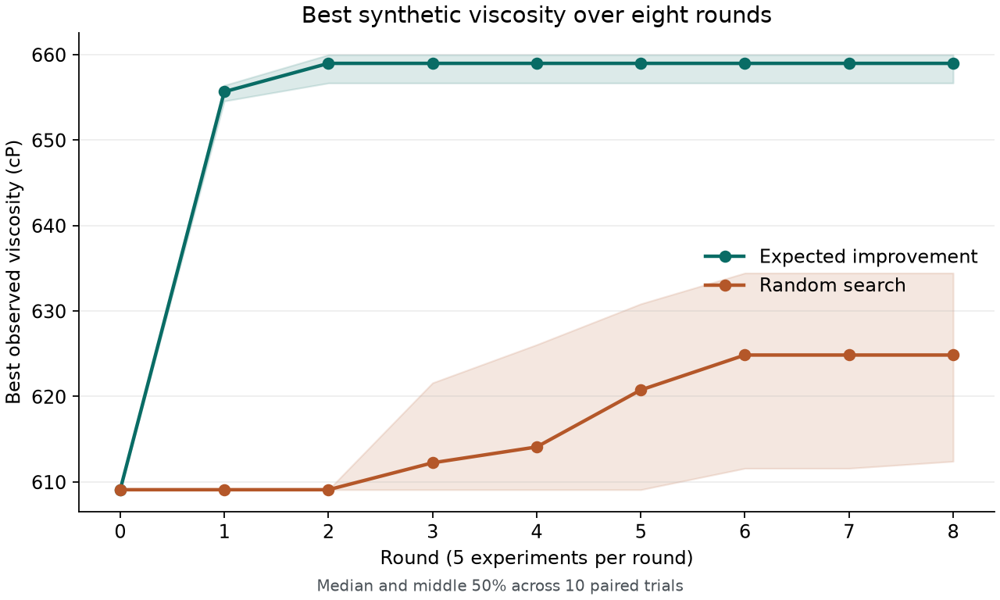

# formulation-loop

A small Python CLI that turns a messy formulation notebook into a clean table
and uses the results to pick five new blends to test. The demo maximizes
synthetic viscosity in centipoise (cP) for a four-ingredient blend.

## Quickstart

Use Python 3.13. From the repository root in Windows PowerShell, run the
following commands. On macOS or Linux, use `.venv/bin/python` for the
environment's Python executable.

```powershell
python -m venv .venv
.\.venv\Scripts\python.exe -m pip install -r requirements.txt
.\.venv\Scripts\python.exe formulation_loop.py generate
.\.venv\Scripts\python.exe formulation_loop.py run notebook.csv
.\.venv\Scripts\python.exe formulation_loop.py simulate --notebook notebook.csv
```

The repository includes the generated notebook, the resulting
[`clean_formulations.csv`](clean_formulations.csv), and the simulation plot.
`run` accepts a CSV path and an optional `--clean` output path.
`simulate` accepts an optional `--plot` output path.

## How it works

1. The parser maps known header variants such as `RESN`, `filer`, and
   `Viscocity (cP)` to canonical fields. It converts g, kg, and wt% to mass
   fractions. With a complete mix of mass and wt% entries, it divides the
   combined mass entries by their remaining share to infer the total batch
   mass. It fills one missing ingredient by mass balance when the other entries
   establish that balance. Rejected rows get a line number and a reason.
2. A scikit-learn Gaussian process with a fixed Matern kernel learns from the
   clean ingredient fractions and observed viscosity. The CLI ranks sampled
   candidates by expected improvement over the best observation and favors
   spacing between picks in the batch. It prints the predictive mean and
   standard deviation for each pick.
3. Each blend has fractions summing to one. Bounds by mass are 25-65% resin,
   5-28% plasticizer, 12-48% filler, and 3-18% modifier. The display rounds
   percentages to three decimals.

## Measured CLI output

### Clean the notebook and propose five experiments

```text
Accepted 21 rows. Rejected 3 rows.
Recovered one missing ingredient in each of: S21
  Rejected line 23: invalid quantity '350 mL'
  Rejected line 24: missing viscosity
  Rejected line 25: missing ingredient requires a recorded batch mass
Wrote clean table to clean_formulations.csv
Best observed viscosity: 609.09 cP
Next five experiments (mass %, predictions in cP):
 #    resin  plasticizer   filler  modifier   mean +/- std       EI
 1   33.658       14.098   37.087    15.157  628.57 +/- 13.54    19.93
 2   30.638       16.076   36.247    17.038  623.22 +/- 11.30    14.70
 3   33.301       16.982   37.409    12.307  616.74 +/- 16.48    11.10
 4   30.808       14.964   39.868    14.361  619.19 +/-  9.96    10.91
 5   31.632       11.774   39.880    16.715  612.81 +/- 14.13     7.69
```

### Simulate eight rounds

```text
Synthetic closed loop: 10 paired trials, 8 rounds, 5 experiments per round.
Median best viscosity (cP)
Round   Expected improvement   Random search
    0                 609.09          609.09
    1                 655.65          609.09
    2                 658.97          609.09
    3                 658.97          612.24
    4                 658.97          614.09
    5                 658.97          620.76
    6                 658.97          624.85
    7                 658.97          624.85
    8                 658.97          624.85
Expected improvement finished ahead in 10/10 trials.
Wrote plot to closed_loop.png
```



Each of the 10 paired trials starts from the same 21 observations. Both
methods draw from the same trial-specific pool of 2,048 feasible blends, with
five new evaluations per round for eight rounds. Random search samples
uniformly without replacement. The Gaussian process refits after each batch
using the newly observed values. The chart shows the median and middle 50%
across trials.

## Synthetic objective and limitations

The notebook is generated from a deterministic toy function with a linear
filler term and two Gaussian peaks. The formula gives the response in cP for
a fraction vector `x` in ingredient order (resin, plasticizer, filler, modifier).

```text
330 + 110 * x[filler]
    + 290 * exp(-squared_distance(x, [0.33, 0.16, 0.37, 0.14]) / 0.020)
    + 215 * exp(-squared_distance(x, [0.56, 0.22, 0.16, 0.06]) / 0.012)
```

The simulation uses this function to return measurements. The surrogate sees
only the values already observed. The notebook rounds its starter measurements
to two decimals and includes intentionally broken entries.

The results describe this synthetic function, these starting observations,
and these candidate pools. The small-sample GP uses a fixed length scale and
noise parameter, so its uncertainty depends on those choices. The acquisition
is a finite-pool search with a spacing heuristic for batches. A production
version would need a validated unit and ingredient registry, source records for
inferred and rejected values, replicate measurements to estimate noise, and
prospective validation with actual formulations and process constraints.

Muhammad Abdulrehman, a CS student at Drexel, trains YOLO/RF-DETR detectors for a robot-arm powder-handling lab pipeline.
